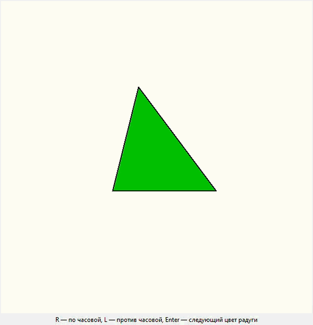

# Лабораторная работа по дисциплине "Компьютерная графика" №1

[](https://github.com/ВАШ_ЛОГИН/Rotating-Triangle-Tkinter.git)
[](https://opensource.org/licenses/MIT)

Программа реализует отображение треугольника с заданными координатами вершин,
закрашенного заданным цветом, с возможностью поворота изображения вокруг центра
масс по часовой и против часовой стрелки, а также циклической смены цвета закраски
по палитре радуги.

## Демонстрация выполнения работы программы



## Описание задачи

Необходимо разработать программу, которая выводит на экран треугольник с
заданными пользователем координатами вершин, закрашенный заданным цветом.
При каждом нажатии клавиши **R** изображение треугольника поворачивается на
заданный угол **по часовой стрелке**, при нажатии клавиши **L** — на тот же
угол **против часовой стрелки**. При каждом нажатии клавиши **Enter** цвет
закраски треугольника циклически меняется на следующий цвет радуги.

## Программа реализована на языке

| Язык | Интерпретатор/Версия | Среда разработки |
| ------ | ------ | ------ |
| Python | Python / 3.14.10  | блокнот |

## Используемые библиотеки

* **tkinter** — встроенная библиотека Python для создания графического интерфейса и отрисовки фигур на холсте
* **math** — модуль стандартной библиотеки для тригонометрических вычислений

> Обе библиотеки входят в стандартную поставку Python, поэтому дополнительная
> установка пакетов через `pip` не требуется.

## Описание возможностей

* Программа запрашивает у пользователя координаты трёх вершин треугольника
  и начальный цвет закраски.
* Перед отрисовкой треугольник автоматически **центрируется** в окне и при
  необходимости **масштабируется**, чтобы не выходить за границы холста при
  вращении.
* Вращение выполняется относительно **центра масс** треугольника (центроида)
  по матрице поворота; ось Y в Tkinter направлена вниз, поэтому положительный
  угол соответствует повороту по часовой стрелке.
* Управление с клавиатуры:
  * **R** — поворот изображения на заданный угол по часовой стрелке;
  * **L** — поворот изображения на заданный угол против часовой стрелки;
  * **Enter** — смена цвета закраски на следующий цвет радуги (по кругу).
* Угол поворота задаётся константой `ANGLE = 15`.

## Установка и запуск

## Установка и запуск:
1. Клонируйте репозиторий:
```sh
git clone https://github.com/VadimFitsura/drawing-geometric-shapes.git
```
2. Откройте терминал в папке проекта и выполните следующую команду:
```sh
python triangle.py
```